# Prototype

**Beautiful, honest websites for roofers and other local trades, built by Claude Code in minutes.**

<a href="examples/cinematic-horizon/">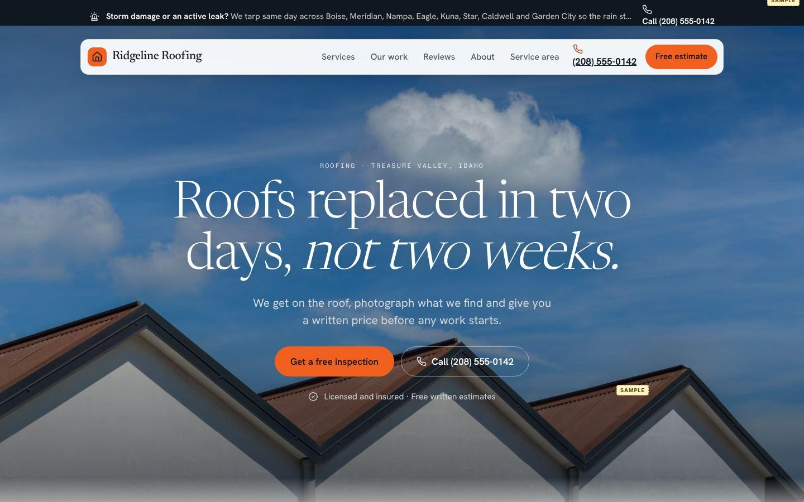</a>&nbsp;<a href="examples/cinematic-horizon/">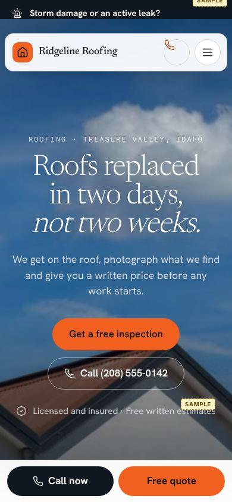</a>

Open this repo in [Claude Code](https://claude.com/claude-code) and you get:

- **`/prototype`**: give it a business name, trade, town and phone, or just their current website or Google listing. It returns a fully clickable 15-17 page site (home, services plus a page per service, work, reviews, about, service area, contact, thank-you) in one of 10 styles, with copy written for that business, a deslop score, screenshots and a preview link.
- **`/deslopify`**: audits any site against **100 indicators of vibecoded slop**, proposes fixes as before/after mockups, and gives you a review page to accept or reject each one. Accepted fixes are applied as patches.
- **A reference library** that both skills draw on: 177 hand-annotated Mobbin references across 15 section types, 13 style directions, and 35 real trade-business sites distilled into 38 conversion patterns.

When you open the repo, Claude reads `CLAUDE.md`, checks the toolkit (`scripts/status.mjs`) and opens with a status update and examples to try.

## Quick start

```bash
git clone https://github.com/deaconb28-lang/prototype && cd prototype
npm install                      # Playwright, for screenshots and audits
npx playwright install chromium  # only if you don't already have a browser for Playwright
claude
```

Then try:

```
/prototype Ridgeline Roofing, roofer in Boise ID, (208) 555-0142
/prototype https://some-plumber-you-want-to-pitch.com
/prototype https://maps.app.goo.gl/...        (set GOOGLE_PLACES_API_KEY for rating and reviews)
/deslopify deslop/fixtures/vibecoded-roofer   (a deliberately sloppy page, to see the review flow)
/deslopify https://any-live-site.com          (audit + mockups: "your site scores 34, here it is at 88")
```

Requirements: Node 18+ and Claude Code. Optional: a Mobbin account (to refresh the library), a Google Places API key (to pull ratings and reviews from Google links), and Vercel or Netlify (for live preview links).

## The 10 styles

Any style works with any trade. Full catalog: [`styles/`](styles/README.md).

| | | | | |
|---|---|---|---|---|
| <a href="examples/cinematic-horizon/"></a><br>**Cinematic Horizon**<br>roofing | <a href="examples/jobsite-industrial/">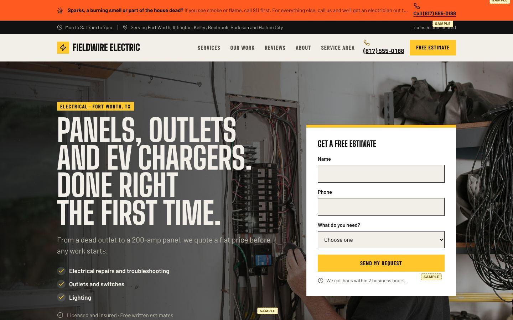</a><br>**Jobsite Industrial**<br>electrical | <a href="examples/blueprint-spec/">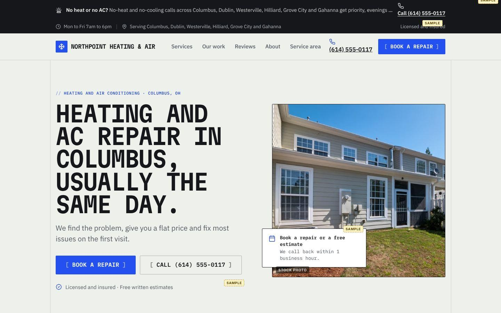</a><br>**Blueprint Spec**<br>HVAC | <a href="examples/heritage-ledger/">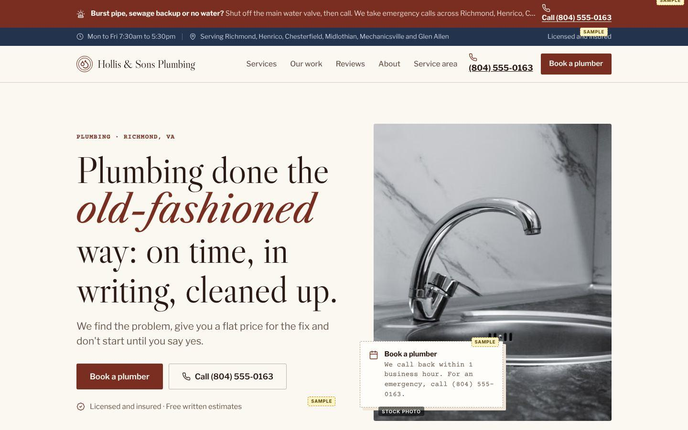</a><br>**Heritage Ledger**<br>plumbing | <a href="examples/editorial-warm/">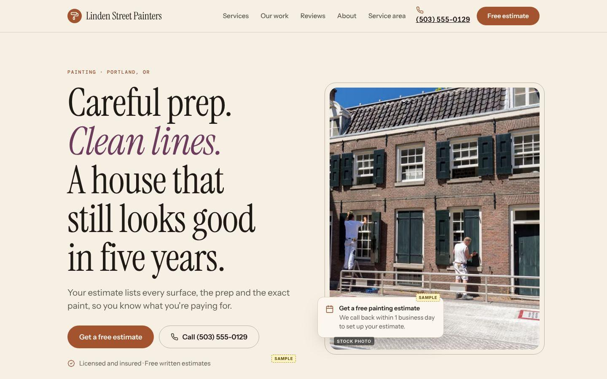</a><br>**Editorial Warmth**<br>painting |
| <a href="examples/field-guide/">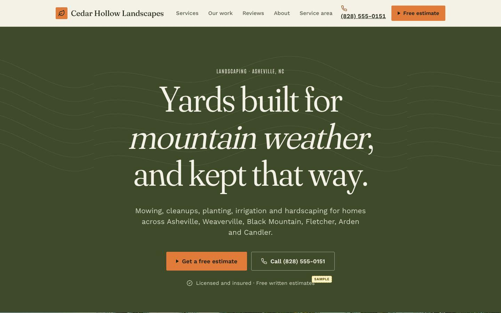</a><br>**Field Guide**<br>landscaping | <a href="examples/market-fresh/">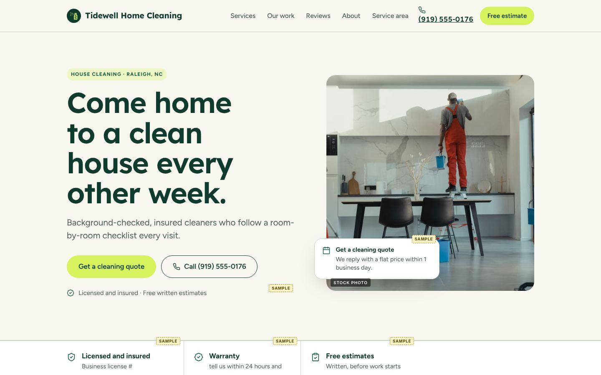</a><br>**Market Fresh**<br>cleaning | <a href="examples/poster-pop/">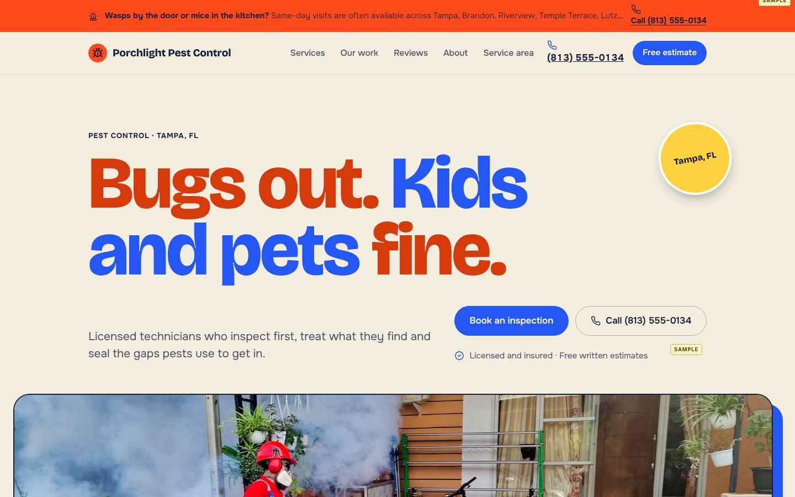</a><br>**Poster Pop**<br>pest control | <a href="examples/nocturne-premium/">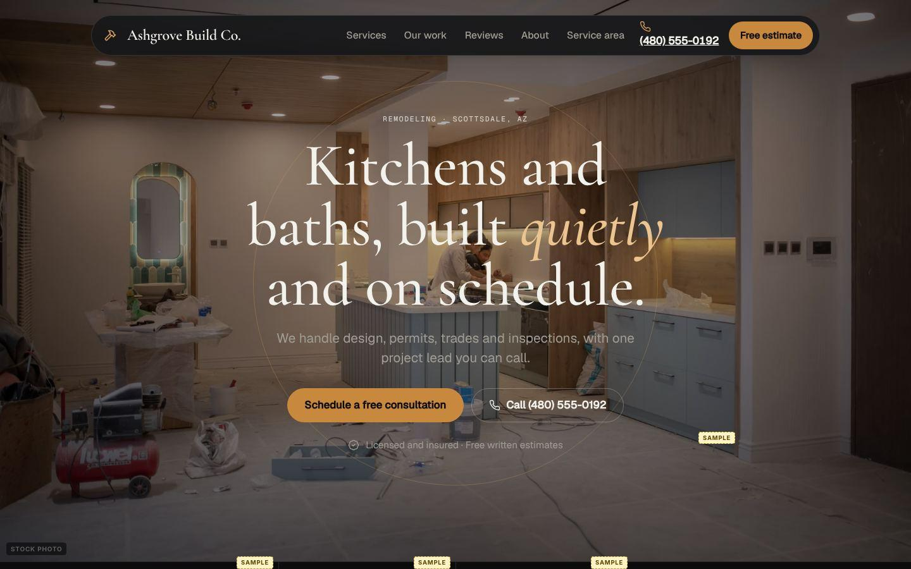</a><br>**Nocturne Premium**<br>remodeling | <a href="examples/wide-stance/">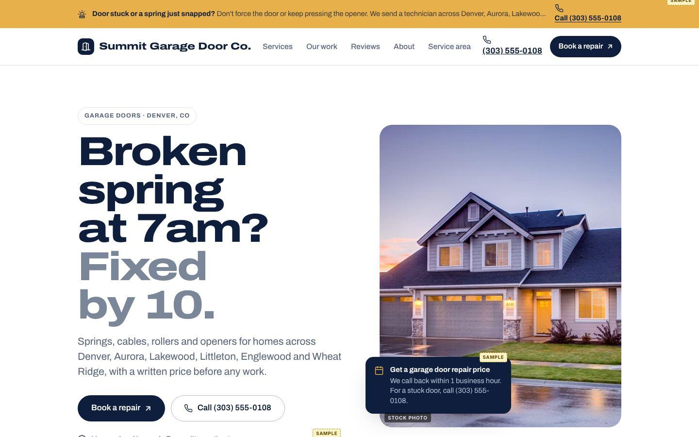</a><br>**Wide Stance**<br>garage doors |

The examples are fictional businesses (555 numbers). Each built site is in `examples/<style>/site/`; open `index.html` to click through. All ten score 99-100 on the automatic deslop checks.

## How it works

```
library/  ──►  styles/ (10)  ×  trades/ (10)  ──►  engine/  ──►  sites/<slug>/dist  ──►  deslop/
Mobbin refs,   tokens, fonts,    services, FAQs,     site.json      static HTML/CSS,      100 indicators,
directions,    layout variants   quote form, photos  → 15-17 pages  schema, call bar      fixes, review, apply
trade patterns
```

- **Styles × trades.** A roofer and a plumber need the same page structure; what differs is services, wording, trust signals and photos. So a *style* (typography, palette, shape, a layout variant for each section) is separate from a *trade pack* (content, quote-form fields, emergency and financing defaults, schema.org type, curated placeholder photos). 10 × 10 gives 100 combinations, and adding a trade is one JSON file.
- **Built for calls.** Tap-to-call everywhere, a sticky mobile call/quote bar, the trade and town in the first screen, a short trade-specific quote form with a "we call back within..." promise, service-area pages, and LocalBusiness schema. These patterns come from the trade-site research in `library/trade-patterns.json`.
- **Fast and portable.** The output is plain HTML and CSS with about 1 KB of JavaScript, no framework and no build step to host it. Drop `dist/` on any static host.

## Honest by design

Prototypes for real businesses never invent years in business, license numbers, ratings, reviews, certifications or guarantees. Anything unconfirmed renders with a visible **Sample** or **Stock photo** tag, a `--final` build refuses while any remain, and `/deslopify --prototype` lists them as launch blockers. Sample reviews are never added to schema markup.

## Deslopify

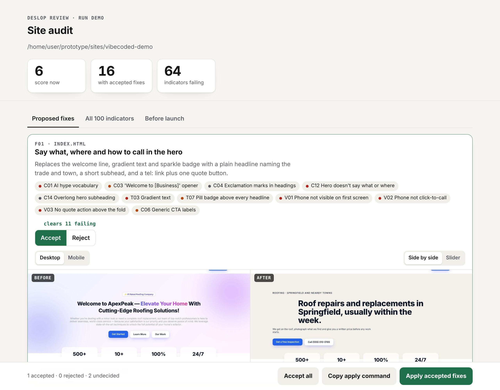

The 100 indicators (`deslop/indicators.json`) cover copy and voice, typography, color, layout, imagery, decoration, components, motion, trust and honesty, trade conversion, and accessibility and technical basics. 82 are checked by script on rendered pages at desktop and mobile sizes (fonts, gradients, contrast, tap targets, phone visibility, stat counters, scroll-reveal, schema and more), and 18 are judged by Claude from screenshots (AI image tells, cheesy stock poses, monotonous section rhythm...). The score is `100 × (1 − failing weight ÷ checked weight)²`.

The flow is `audit → visual.json → fix candidates → review page → apply`, and all of it lives in `.deslop/<run>/`. See [`.claude/skills/deslopify/SKILL.md`](.claude/skills/deslopify/SKILL.md).

## Reference library

[`library/`](library/README.md) holds Mobbin page links plus written observations (layout, approximate sizes and colors, crafted details, how a trade would adapt it). No Mobbin images are stored, since this repo is public. `.mcp.json` declares Mobbin's MCP server (`https://api.mobbin.com/mcp`); connect it with `/mcp` → mobbin → Authenticate, then run `/refresh-library` to re-scrape or extend.

## Optional: status before the first message

`CLAUDE.md` already has Claude check the toolkit and greet you. To inject the status before Claude's first reply instead, copy the hook in [`docs/optional-session-hook.json`](docs/optional-session-hook.json) into `.claude/settings.json`.

## Repo map

```
.claude/skills/   prototype, deslopify, refresh-library
library/          reference library (see library/README.md)
styles/           10 styles (style.json + style.css)
trades/           10 trade packs + photos.json (curated Pexels placeholders)
engine/           build.mjs, components.mjs, icons.mjs, assets/base.css, assets/site.js
deslop/           indicators.json, audit, collect, fix, review, serve, apply, fixtures/
scripts/          status, extract, screenshot, serve, build-examples
examples/         one demo site per style
sites/            your prototypes (gitignored)
```

## Credits

Icons from [Lucide](https://lucide.dev) (ISC). Placeholder photos from [Pexels](https://www.pexels.com/license/), labeled as stock in every prototype. Fonts from Google Fonts (OFL). Design references link to [Mobbin](https://mobbin.com); the observations are original. Code is MIT licensed.
