# Examples

One fictional business per style (made-up names, 555 phone numbers), built with `node scripts/build-examples.mjs`. Each folder holds the `site.json` that produced it, the built `site/` (open `site/index.html`), and screenshots.

The **Sample** and **Stock photo** tags are deliberate: they show what a fresh prototype looks like before the business confirms its facts and sends real photos.

## Cinematic Horizon: Ridgeline Roofing (roofing, Boise ID)

Big-sky photography, a calm white serif centered in the light, and a floating nav pill. Like an opening film still.

<a href="cinematic-horizon/screens/index-desktop-full.jpg">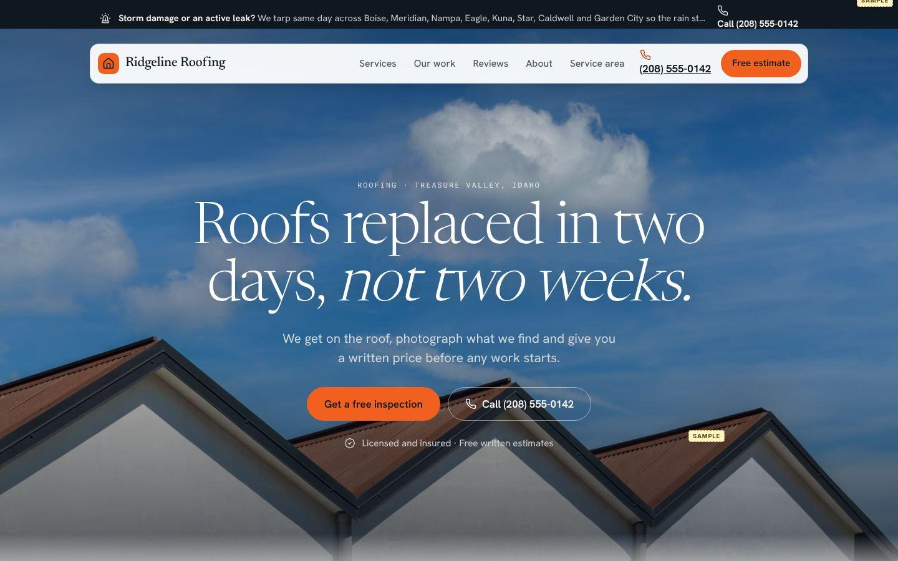</a> 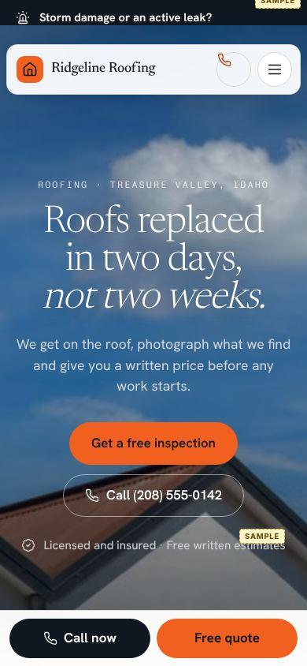

[site.json](cinematic-horizon/site.json) · [built site](cinematic-horizon/site/index.html) · [full page](cinematic-horizon/screens/index-desktop-full.jpg)

## Jobsite Industrial: Fieldwire Electric (electrical, Fort Worth TX)

Tall condensed caps, concrete and black, hi-vis yellow. Built like signage on a work truck.

<a href="jobsite-industrial/screens/index-desktop-full.jpg">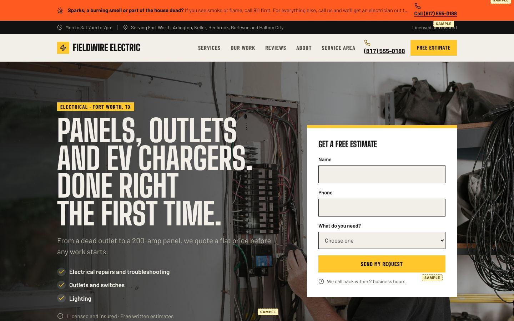</a> 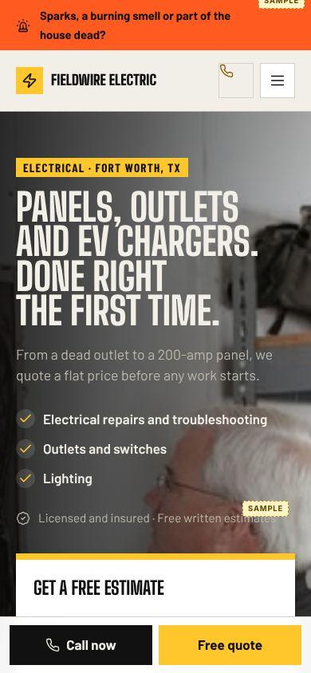

[site.json](jobsite-industrial/site.json) · [built site](jobsite-industrial/site/index.html) · [full page](jobsite-industrial/screens/index-desktop-full.jpg)

## Blueprint Spec: Northpoint Heating & Air (hvac, Columbus OH)

A technical spec sheet: monospace caps, bracketed buttons, guide lines and spec lists. For trades that sell precision.

<a href="blueprint-spec/screens/index-desktop-full.jpg">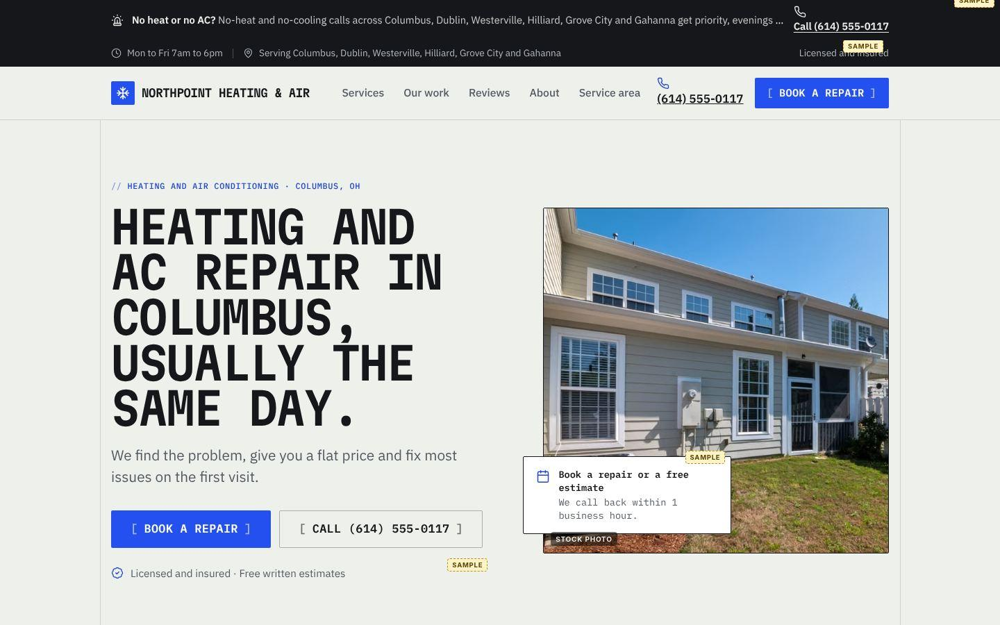</a> 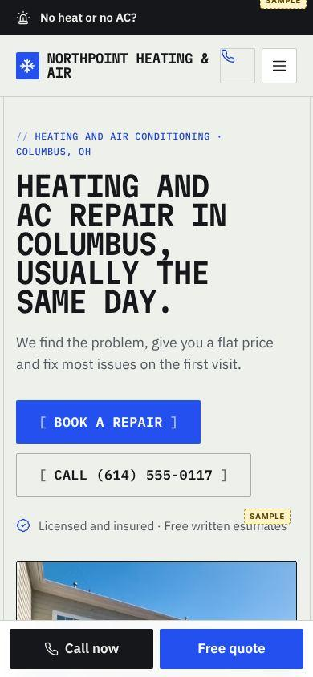

[site.json](blueprint-spec/site.json) · [built site](blueprint-spec/site/index.html) · [full page](blueprint-spec/screens/index-desktop-full.jpg)

## Heritage Ledger: Hollis & Sons Plumbing (plumbing, Richmond VA)

Established and trustworthy: Caslon serif in espresso and oxblood on paper, ledger rules, typewriter figures and a navy footer.

<a href="heritage-ledger/screens/index-desktop-full.jpg">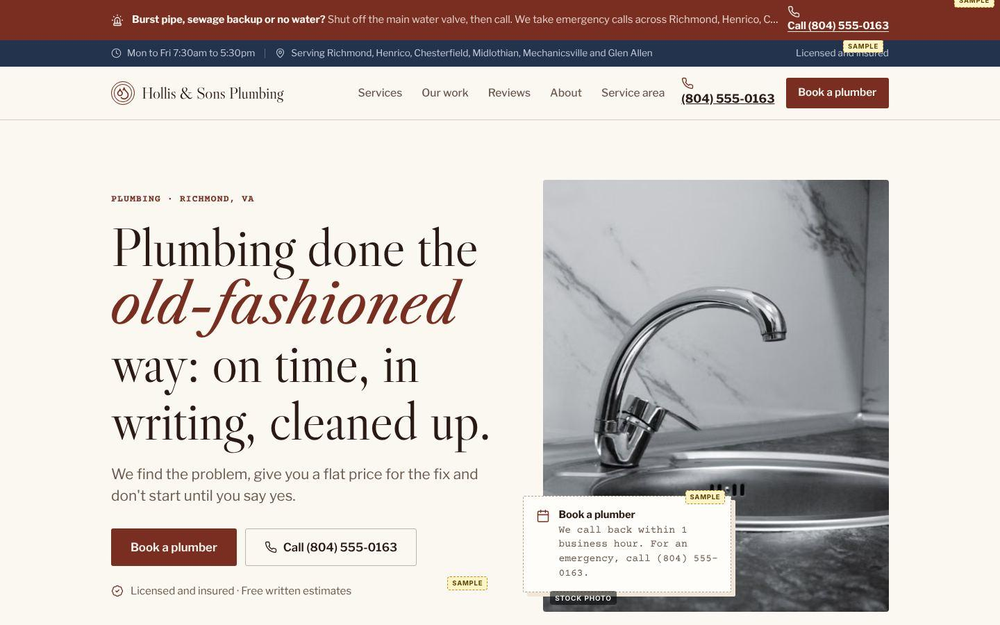</a> 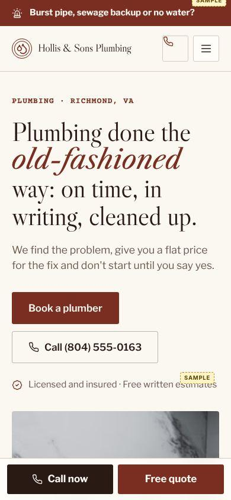

[site.json](heritage-ledger/site.json) · [built site](heritage-ledger/site/index.html) · [full page](heritage-ledger/screens/index-desktop-full.jpg)

## Editorial Warmth: Linden Street Painters (painting, Portland OR)

Small-press magazine. Light serif with one italic word, cream paper, terracotta, photos inset like printed plates.

<a href="editorial-warm/screens/index-desktop-full.jpg">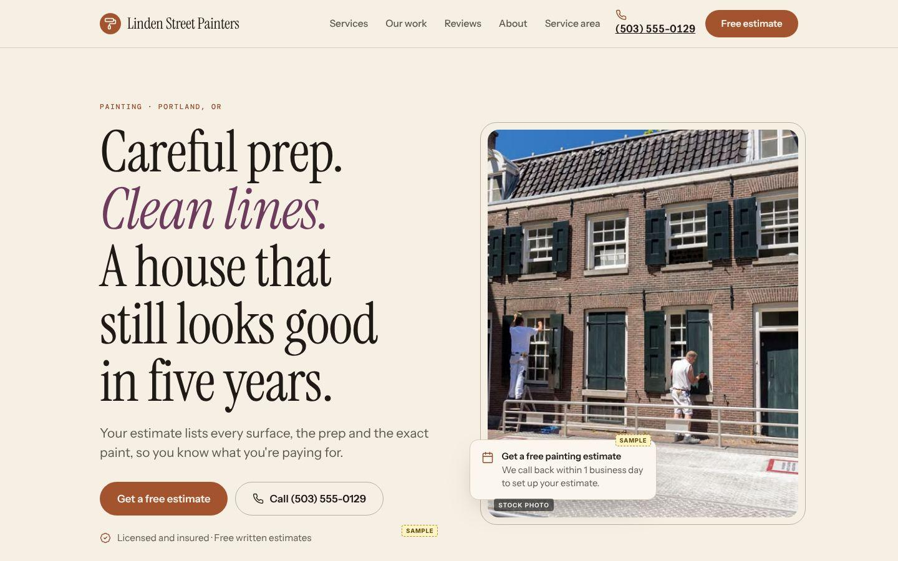</a> 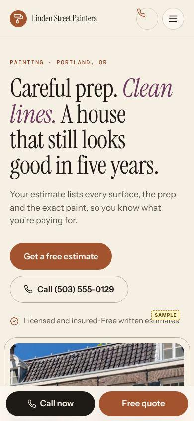

[site.json](editorial-warm/site.json) · [built site](editorial-warm/site/index.html) · [full page](editorial-warm/screens/index-desktop-full.jpg)

## Field Guide: Cedar Hollow Landscapes (landscaping, Asheville NC)

Deep olive fields, soft serif, wide landscape photos and an orange trail-marker accent. The outdoors as a printed guidebook.

<a href="field-guide/screens/index-desktop-full.jpg">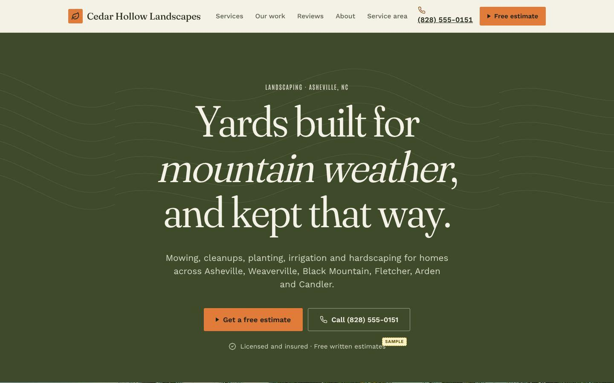</a> 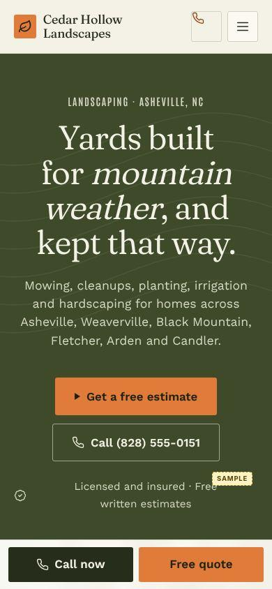

[site.json](field-guide/site.json) · [built site](field-guide/site/index.html) · [full page](field-guide/screens/index-desktop-full.jpg)

## Market Fresh: Tidewell Home Cleaning (cleaning, Raleigh NC)

Fresh and dependable: cream page, forest-green ink, sage bands, hairlines and a lime pill. Like a good neighborhood grocer.

<a href="market-fresh/screens/index-desktop-full.jpg">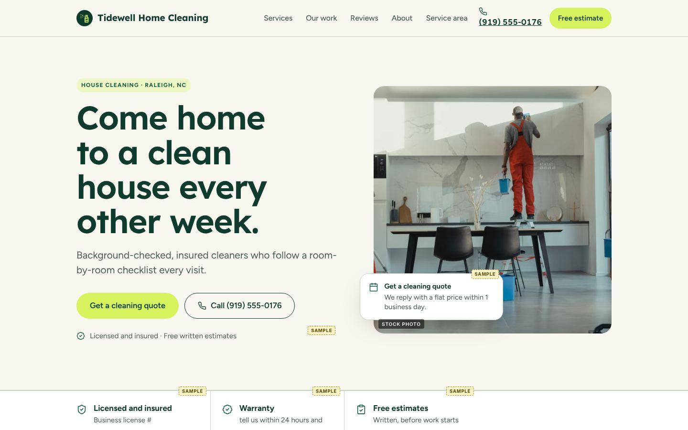</a> 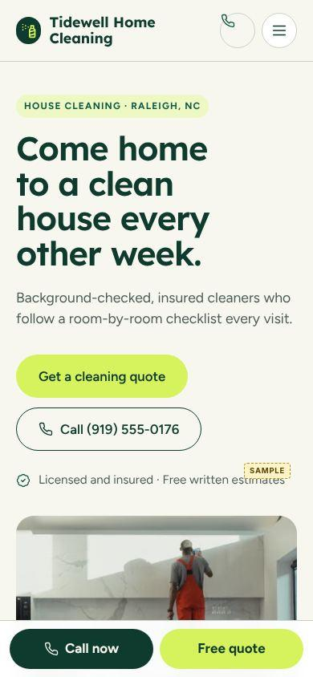

[site.json](market-fresh/site.json) · [built site](market-fresh/site/index.html) · [full page](market-fresh/screens/index-desktop-full.jpg)

## Poster Pop: Porchlight Pest Control (pest-control, Tampa FL)

Loud, warm and friendly: a giant colored condensed headline on cream, cobalt pills and offset photo blocks. A screen-printed neighborhood poster.

<a href="poster-pop/screens/index-desktop-full.jpg">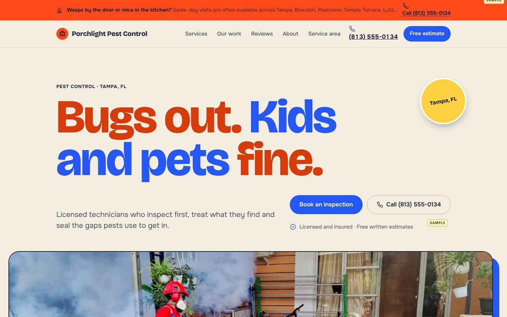</a> 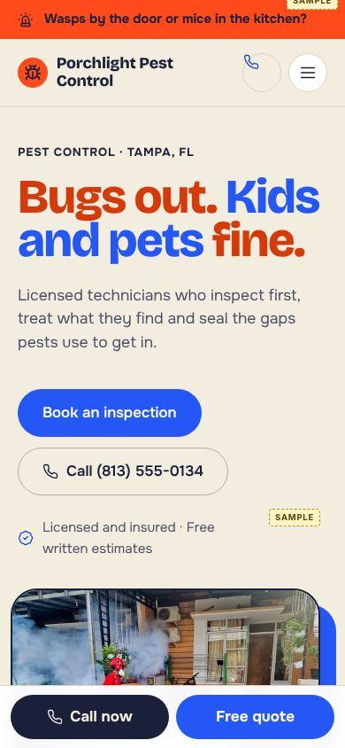

[site.json](poster-pop/site.json) · [built site](poster-pop/site/index.html) · [full page](poster-pop/screens/index-desktop-full.jpg)

## Nocturne Premium: Ashgrove Build Co. (remodeling, Scottsdale AZ)

Near-black, an old-style serif with an italic turn, hairlines and warm brass light. For high-ticket work that should feel like a private studio.

<a href="nocturne-premium/screens/index-desktop-full.jpg">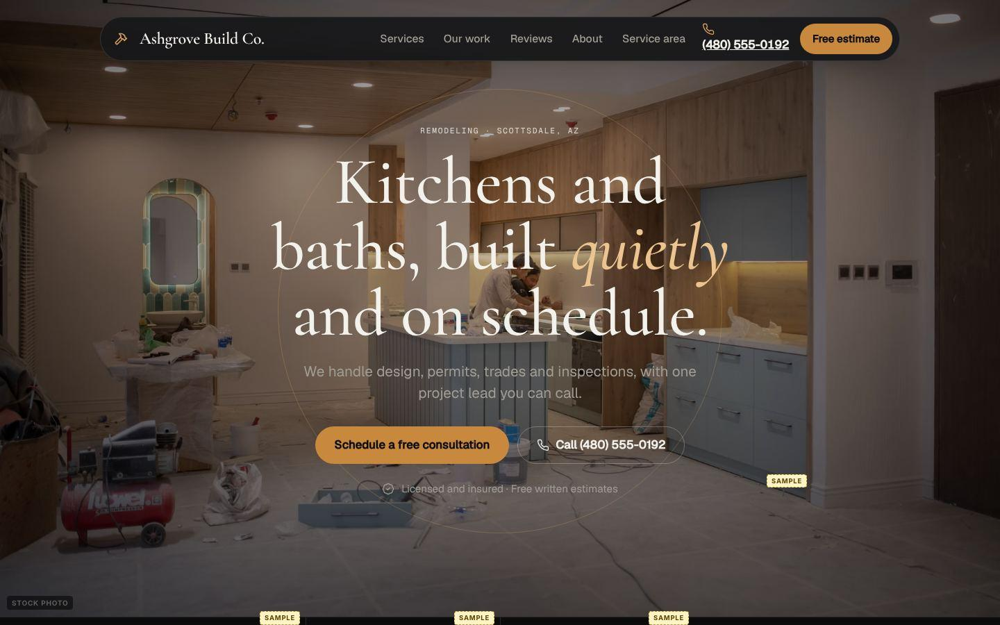</a> 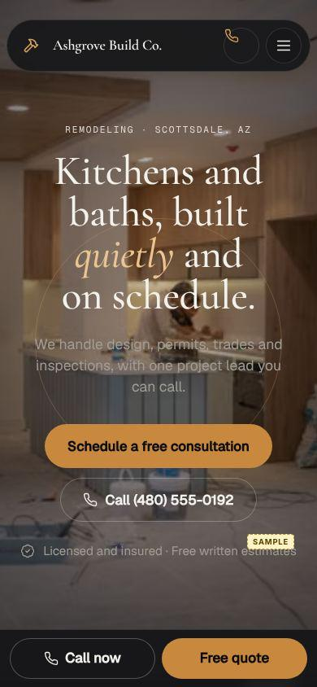

[site.json](nocturne-premium/site.json) · [built site](nocturne-premium/site/index.html) · [full page](nocturne-premium/screens/index-desktop-full.jpg)

## Wide Stance: Summit Garage Door Co. (garage-doors, Denver CO)

Modern contractor confidence: extra-wide heavy display in navy and slate, rounded photo plates, solid navy blocks.

<a href="wide-stance/screens/index-desktop-full.jpg">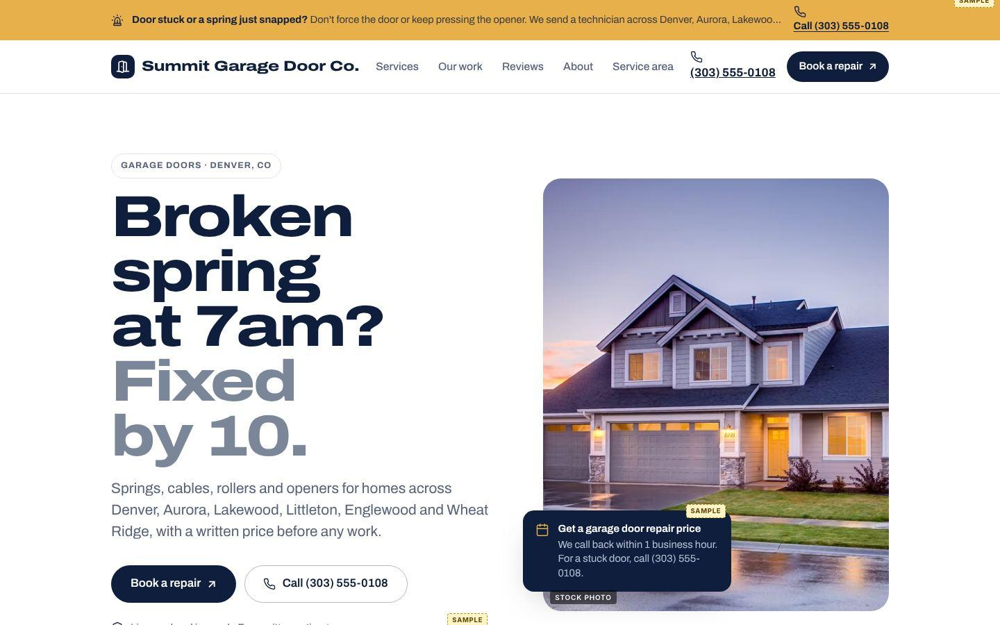</a> 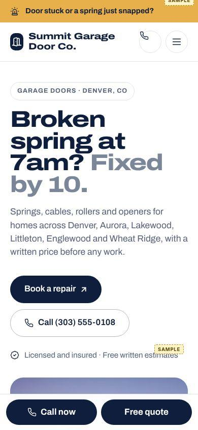

[site.json](wide-stance/site.json) · [built site](wide-stance/site/index.html) · [full page](wide-stance/screens/index-desktop-full.jpg)

