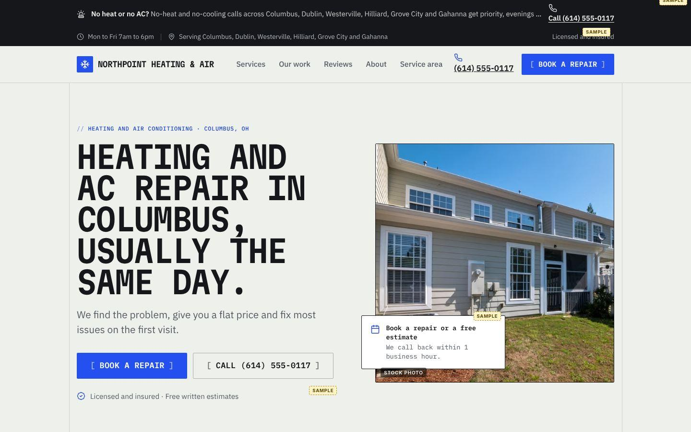
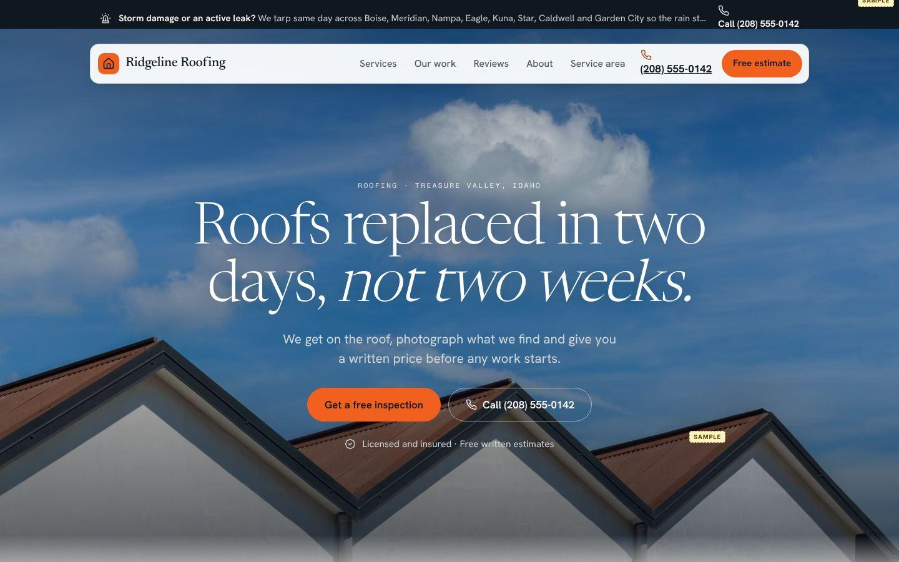
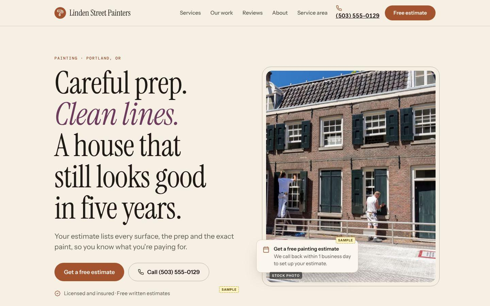
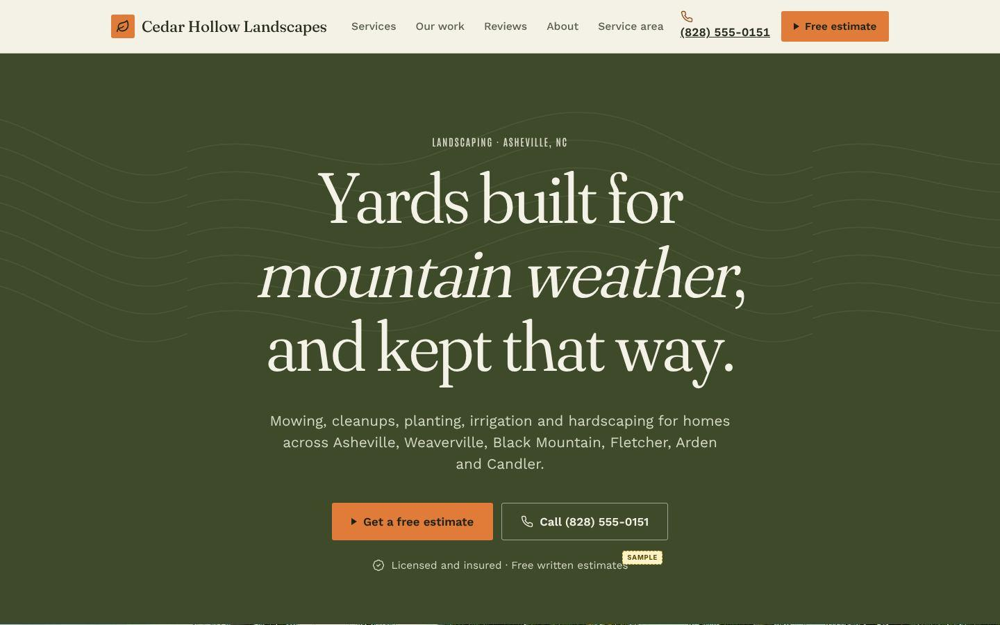
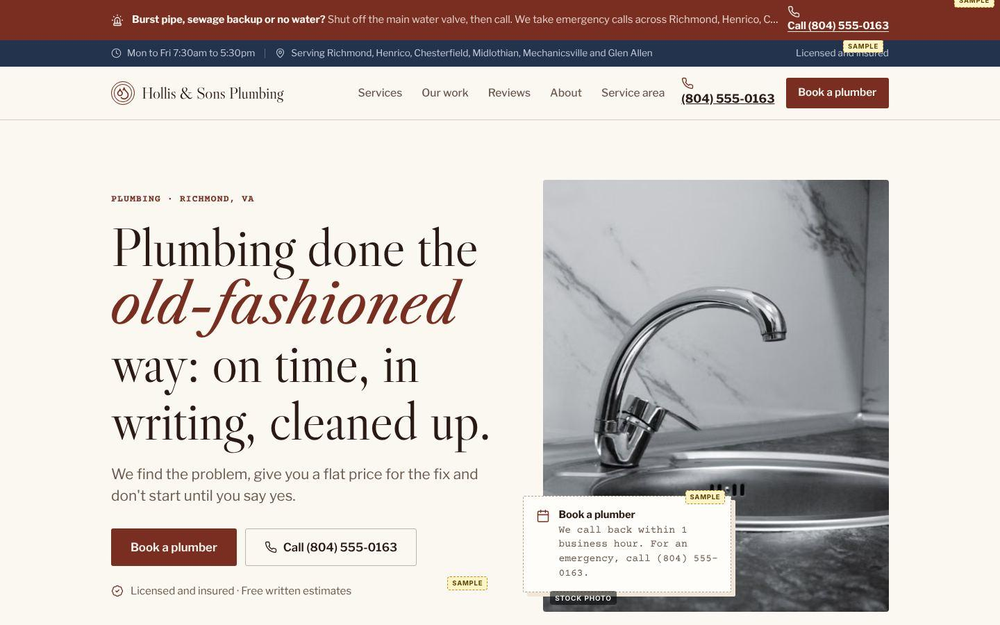
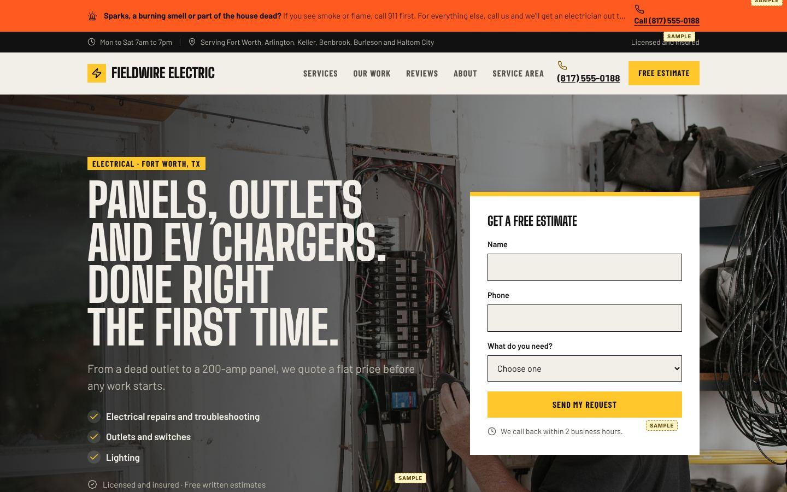
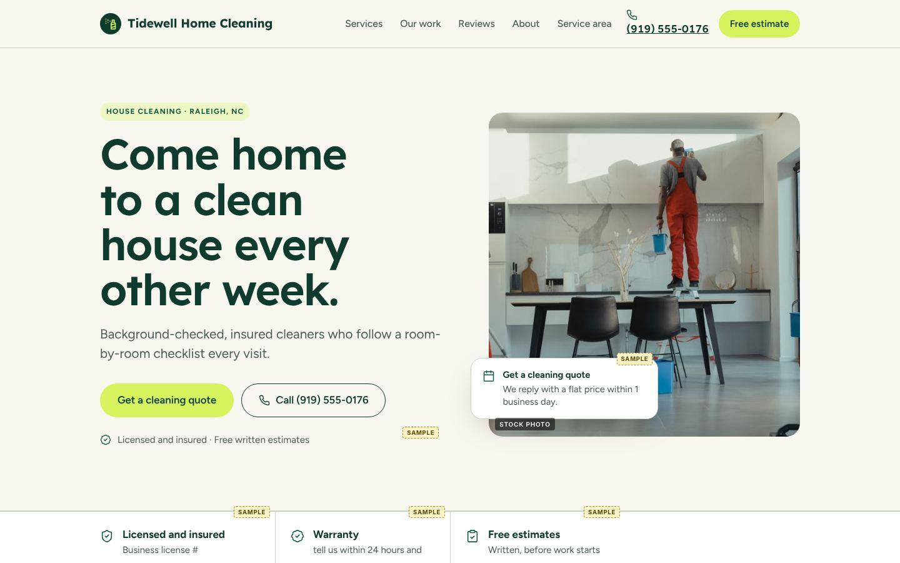
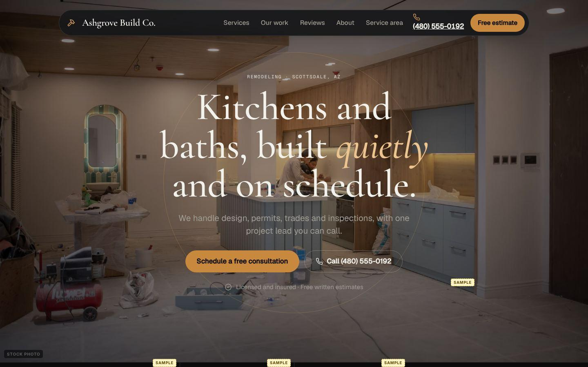
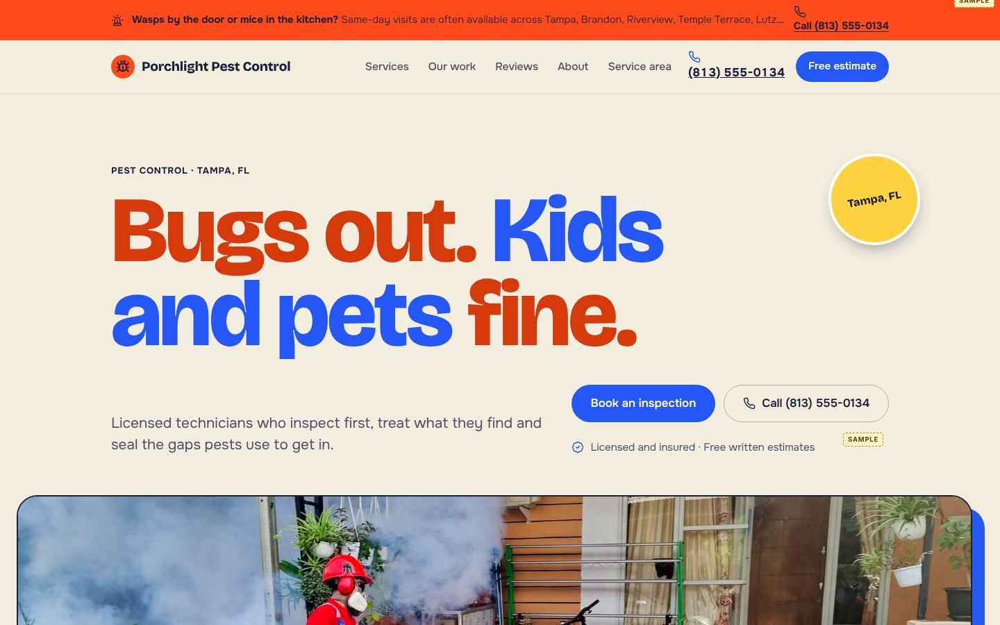
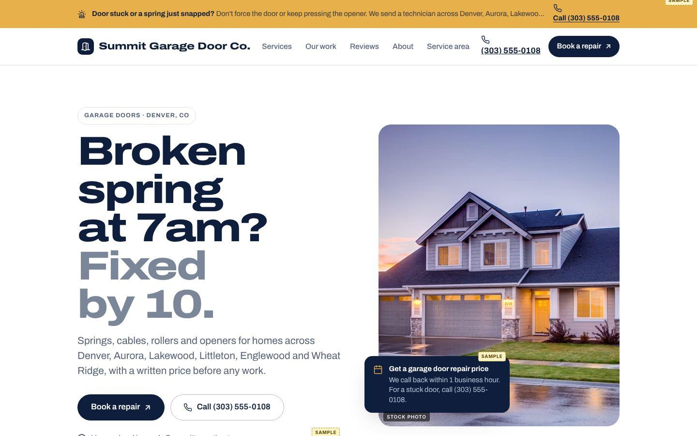

# Styles

Ten visual systems. Each one works with any trade pack in `trades/`. A style is `style.json` (design tokens, Google Fonts, which layout variant each section uses, and the Mobbin references it was derived from) plus `style.css` (its signature details).

Every text and button color pair passes WCAG AA, and each example site scores 99-100 on the automatic deslop checks. Pick one by trade or by brand feel; switching is one line in `site.json`.

| | Style | Feel | Best for | Type | Layout |
|---|---|---|---|---|---|
|  | **Blueprint Spec** `blueprint-spec` | A technical spec sheet: monospace caps, bracketed buttons, guide lines and spec lists. For trades that sell precision. | electrical, hvac, plumbing, garage-doors | Martian Mono + IBM Plex Sans + IBM Plex Mono | hero: split · nav: utility · services: list |
|  | **Cinematic Horizon** `cinematic-horizon` | Big-sky photography, a calm white serif centered in the light, and a floating nav pill. Like an opening film still. | roofing, landscaping, electrical, hvac | Newsreader + Hanken Grotesk + Fragment Mono | hero: fullbleed · nav: pill · services: tiles |
|  | **Editorial Warmth** `editorial-warm` | Small-press magazine. Light serif with one italic word, cream paper, terracotta, photos inset like printed plates. | painting, remodeling, landscaping, cleaning | Instrument Serif + Instrument Sans + DM Mono | hero: split · nav: bar · services: list |
|  | **Field Guide** `field-guide` | Deep olive fields, soft serif, wide landscape photos and an orange trail-marker accent. The outdoors as a printed guidebook. | landscaping, pest-control, roofing, painting | Fraunces + Work Sans + Antonio | hero: editorial (dark) · nav: bar · services: split |
|  | **Heritage Ledger** `heritage-ledger` | Established and trustworthy: Caslon serif in espresso and oxblood on paper, ledger rules, typewriter figures and a navy footer. | roofing, plumbing, remodeling, hvac | Libre Caslon Display + Libre Caslon Text + Libre Franklin + Courier Prime | hero: split · nav: utility · services: list |
|  | **Jobsite Industrial** `jobsite-industrial` | Tall condensed caps, concrete and black, hi-vis yellow. Built like signage on a work truck. | roofing, garage-doors, electrical, hvac, plumbing | Big Shoulders Display + Barlow + Barlow Condensed | hero: form · nav: utility · services: list |
|  | **Market Fresh** `market-fresh` | Fresh and dependable: cream page, forest-green ink, sage bands, hairlines and a lime pill. Like a good neighborhood grocer. | cleaning, landscaping, pest-control, plumbing | Lexend + Figtree | hero: split · nav: bar · services: cards |
|  | **Nocturne Premium** `nocturne-premium` | Near-black, an old-style serif with an italic turn, hairlines and warm brass light. For high-ticket work that should feel like a private studio. | remodeling, electrical, landscaping, garage-doors | Cormorant Garamond + Geist + Geist Mono | hero: fullbleed · nav: pill · services: split |
|  | **Poster Pop** `poster-pop` | Loud, warm and friendly: a giant colored condensed headline on cream, cobalt pills and offset photo blocks. A screen-printed neighborhood poster. | cleaning, pest-control, painting, plumbing | Bricolage Grotesque + Onest | hero: editorial · nav: bar · services: cards |
|  | **Wide Stance** `wide-stance` | Modern contractor confidence: extra-wide heavy display in navy and slate, rounded photo plates, solid navy blocks. | remodeling, garage-doors, roofing, hvac | Archivo | hero: split · nav: bar · services: tiles |

## Where they came from

Each style is built from a direction in `library/styles-research/directions.json`, which cites the Mobbin pages it was drawn from (also listed under `references` in each `style.json`). Mobbin has very few real trade businesses, so the directions come from adjacent categories (solar, construction, real estate, architecture, outdoor brands, food) and are then adapted with the conversion patterns real trade sites use (`library/trade-patterns.json`).

## Making a new style

1. Copy a style folder. Change `id`, `name`, `summary`, `best_for`, `fonts` (Google Fonts `family=` strings) and `tokens`.
2. Choose `variants` per section: nav `bar | pill | utility`; hero `split | fullbleed | editorial | form | contained` (+ `heroTone: "dark"`); services `cards | list | tiles | split`; process `row | timeline`; gallery `grid | strip`; reviews `quote | cards`; faq `twocol | stack`; cta `band | card`.
3. Put signature details in `style.css`, scoped with `.style-<id>`.
4. Add a demo to `examples/demos.json`, run `node scripts/build-examples.mjs --only <id>`, then `node deslop/audit.mjs examples/<id>/site --prototype`.
